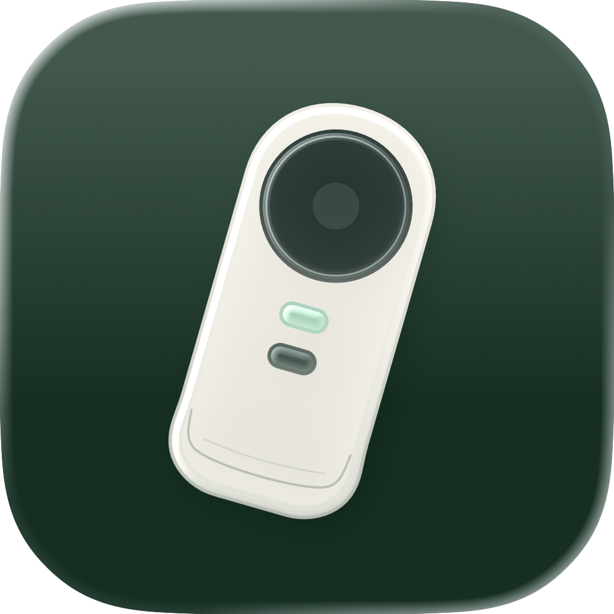
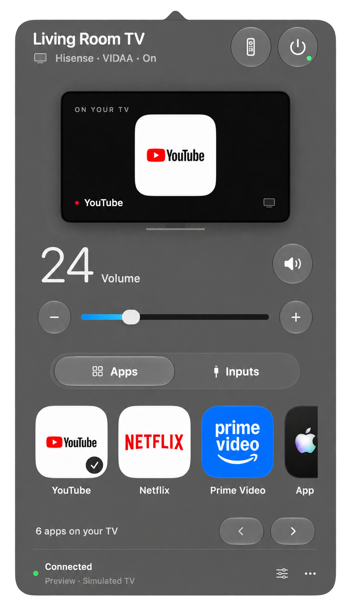
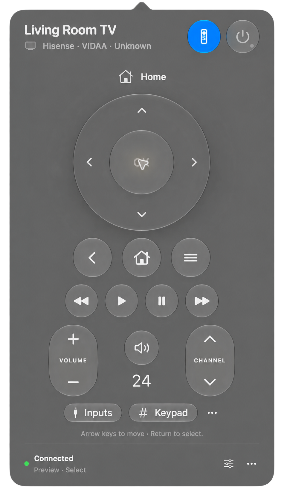
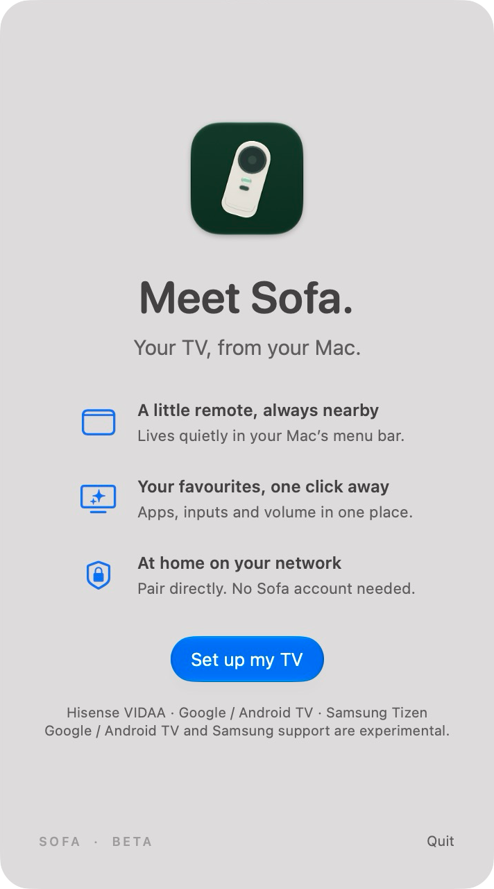

<p align="center"></p>
<h1 align="center">Sofa</h1>
<p align="center"><strong>Your TV, from your Mac.</strong></p>
<p align="center">Your TV. Within reach.</p>
<p align="center">A free, open-source menu-bar remote for Hisense VIDAA, with experimental Google / Android TV and Samsung Tizen support.</p>

Sofa brings your TV’s remote, apps, inputs and volume into a small native macOS panel. Built with SwiftUI, AppKit and Apple’s Liquid Glass components.

**Beta software. macOS 26 or later · Apple silicon.** VIDAA has been tested with one Hisense A4K-series TV. Google / Android TV support in 0.4 is experimental and currently validated with a local protocol fixture, not physical Android TV hardware. Compatibility varies by model and firmware. This is independent software, not an official Hisense, VIDAA or Apple product.

<p align="center">
  
  
  
</p>
<p align="center"><sub>Home · Remote · Setup. App previews with backgrounds removed for presentation and simulated TV state.</sub></p>

## Download

Visit the [Sofa website](https://iamrainhard.github.io/sofa/) or [GitHub Releases](https://github.com/iamrainhard/sofa/releases/tag/v0.5.0-beta.1-build13).

**Build 13 is Developer ID signed and Apple notarized.** The DMG contains the approved app with its notarization ticket stapled, an Applications shortcut and installation instructions. The app inside the DMG and ZIP passes Gatekeeper assessment. SHA-256 checksums are included. Open Sofa normally after installing it; macOS may ask you to confirm opening a downloaded app.

1. [Download the DMG](https://github.com/iamrainhard/sofa/releases/download/v0.5.0-beta.1-build13/Sofa-0.5.0-beta.1-build13-arm64-notarized.dmg), open it, and drag **Sofa** onto **Applications**. Eject the disk image.
2. Open Sofa. Its icon appears in your menu bar; it has no persistent Dock window.
3. Keep your Mac and TV on the same home network. Allow Local Network access when macOS asks.
4. Choose **Set up my TV**. Discover a nearby compatible TV or enter the private IPv4 address shown in the TV’s network settings.
5. Sofa detects the connection platform; you can also choose it manually. Verify the address and trust the TV’s certificate. VIDAA uses a numeric pairing code; Google / Android TV displays a six-character hexadecimal code (digits and A–F). For Samsung Tizen, select **Allow** on the TV.
6. Once paired, choose a name and open Sofa. Existing VIDAA pairings are preserved when upgrading.

No Python, Homebrew, Xcode or Sofa account is required to use the packaged app. Login startup is optional and off by default.

## What’s inside

- Native glass menu-bar interface and an original layered app icon.
- Circular glass clickpad with centre OK, Home, Back and Menu, inspired by the Siri Remote.
- Compact active-app icon and name on the remote; original catalog transparency is preserved.
- Playback buttons, volume and channel rockers, mute and numeric keypad.
- Horizontal app shelf with logos from your own TV catalog, plus input selection.
- TV-reported active app/input and power status; pending changes are shown honestly.
- Smooth volume interaction with coalesced commands and delayed readback protection.
- Pairing credentials stored in macOS Keychain and TV certificate pinning.
- First-run pairing, TV naming, reconnect-on-launch preference and optional login startup.
- Local Network permission guidance, a Privacy & Security settings shortcut and recoverable Keychain errors.
- Keyboard arrows and Return for the remote, accessibility labels, Reduce Motion support.

The TV illustration shows app/input identity, not screen mirroring. Sofa controls the current VIDAA OS; it does not replace firmware, install TV apps, bypass subscriptions or provide voice search. Network wake depends on the TV’s standby settings. Bluetooth/audio routing and Google Cast media casting are not included. Google TV remote control uses Android TV Remote Service instead.

## Platform support

| Platform | Status | Behavior |
| --- | --- | --- |
| Hisense VIDAA | Tested on one A4K-series TV | Existing remote, app/input catalogs and absolute-volume slider retained. |
| Google TV / Android TV, any brand | Experimental in 0.4 | Requires Android TV Remote Service v2. On-screen PIN pairing, navigation, playback keys, volume controls, current app/power/volume reports where supplied, app shortcuts and input-menu key. |
| Samsung Tizen | Experimental in 0.5 | Secure remote service, on-TV Allow approval, navigation, playback, volume keys and a slider when a compatible UPnP volume service responds. Hardware testing pending. |
| Roku, Fire TV, Xumo | Not implemented | Selecting Android TV does not make these devices compatible. |

Android support is platform-based, not restricted to Hisense. A TV must expose Android TV Remote Service; generic Android boxes without that service are not supported. No root, ADB or developer mode is needed. Discovery uses Bonjour and VIDAA SSDP (plus Samsung SSDP in build 13), with private IPv4/manual setup as a fallback.

Android app tiles are **shortcuts, not a detected installed-app list**. Apps must already be installed and handle the link. Android keeps the glass slider when volume feedback is available: Sofa sends one relative key at a time, follows the latest drag target, and settles to the nearest native volume step. If feedback stalls, it stops and falls back to −/+ until reconnect. It may respond more slowly than VIDAA’s direct setter. Input, channel, mute and wake behavior depend on the television and audio setup. If a manufacturer keyboard behaves poorly, disable **Keyboard and current app updates** in Settings and reconnect. No voice recording is implemented.

## Experimental Samsung Tizen (build 13)

The **0.5.0-beta.1 build 13** beta adds Samsung Tizen support. No physical Samsung TV has been tested.

- Find a Samsung TV on the local network, or select **Samsung Tizen · Experimental** and enter its private IPv4 address. This adapter requires the secure Tizen WebSocket service on TCP 8002; older Orsay and plaintext-only models are not supported.
- Verify the TV address and trust its certificate. Select **Allow** on the television using its physical remote. No PIN, SmartThings account, root or developer mode is required. Sofa saves the pairing token in its own Keychain namespace for reconnects. Denied or expired requests have a retry path.
- Navigation, playback, volume keys, mute, numeric/channel keys and the input-menu key use Samsung remote commands. App support varies; native media keys may be ignored by individual apps.
- The glass **volume slider appears only after the TV advertises GetVolume/SetVolume on a compatible 0–100 UPnP service and returns a valid reading**. Sofa confirms changes with readback. If this fails, −/+ remains available; Refresh checks for the slider again. Soundbars and external receivers may behave differently.
- Installed app tiles appear only when the TV supplies its catalog. Otherwise use **Open Home**. Active-app reporting, direct input lists and network wake are not implemented. App-launch requests are not presented as confirmed launches.

The existing VIDAA and Android wire adapters remain unchanged. Automated tests cover all three routes, pairing isolation, local TLS/WebSocket approval and reconnect, SOAP volume readback, fallback states and native UI state. Hardware testing on Samsung is still required before broader compatibility claims.

## Privacy

Commands and pairing go directly to your TV over the local network. Pairing secrets stay in Keychain. No analytics, advertising or Sofa cloud service. Logos are downloaded from VIDAA’s public image CDN and cached locally. See [Privacy](docs/PRIVACY.md) and [Troubleshooting](docs/TROUBLESHOOTING.md).

## Build from source

Requirements: Apple silicon Mac, macOS 26+, Xcode 26+ (selected with `xcode-select`), and [uv](https://docs.astral.sh/uv/).

```sh
bash scripts/check.sh
bash build.sh
```

Output: `build/Sofa.app`. The default source build is ad-hoc signed for local development; it is not a notarized public download. The bridge uses CPython 3.12 and PyInstaller 6.22.3, bundled by the build. The helper rebuilds automatically when adapter sources or pinned dependencies change; `SOFA_REBUILD_HELPER=1` forces a rebuild. See [Releasing](docs/RELEASING.md) for Developer ID signing and notarization.

## Beta coverage

Protocol framing, authentication gates, key payloads, certificate change handling, volume state and catalog identity have automated checks. Android tests use local TLS servers and the actual pinned protocol library to verify PIN pairing, certificate checks, saved reconnect, state updates and wire commands. Router checks reject events/commands from an earlier connection session. These fixtures do not establish compatibility with a physical Android TV. Core Home, arrows/OK, volume and mute were verified with a physical TV during development. Channel controls, every app/input, wake from standby, first installation on another Mac and long-duration sleep/wake need wider beta testing. Please include your model and firmware in an issue, but never pairing codes, tokens, device IDs or private network captures.

## Contribute

See [CONTRIBUTING](CONTRIBUTING.md). Bug reports and compatibility reports are welcome. There are no paid features or subscriptions.

## License and credits

Sofa source and original artwork are MIT licensed. Shared VIDAA protocol research/certificate credits and bundled runtime licenses are in [THIRD_PARTY](docs/THIRD_PARTY.txt) and `Resources/RuntimeLicenses`. Third-party app marks remain their owners’ property and are fetched at runtime, not redistributed as Sofa artwork.
